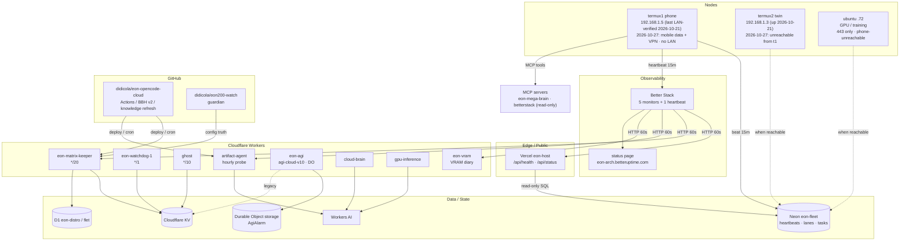

# EON Architecture Map

Live status page: **https://eon-arch.betteruptime.com**

> Better Stack **Catalog relations are paid-only** on the current plan (API returns `403 upgrade required`), so this Mermaid map is the free, versioned source of truth. The status page above is the live uptime view.

## Service graph

## Services and monitors

| Service | Role | Endpoint | Better Stack |
|---|---|---|---|
| EON host | public health | https://eon-host-own-c7f3.vercel.app/api/health | monitor `5100725` |
| EON host | status + quota | https://eon-host-own-c7f3.vercel.app/api/status | monitor `5100726` |
| EON matrix keeper | worker status | https://eon-matrix-keeper.eon-sovereign.workers.dev/status | monitor `5100727` |
| EON artifact agent | worker health | https://artifact-agent.eon-sovereign.workers.dev/healthz | monitor `5100728` |
| EON VRAM diary | diary read | https://eon-vram.eon-sovereign.workers.dev/read?addr=0xa0007000 | monitor `5100729` |
| EON termux1 phone | 15m heartbeat | Neon `eon.heartbeats` + Better Stack | heartbeat `513053` |
| EON AGI (internal) | self-improvement loop | https://eon-agi.eon-sovereign.workers.dev/self · `/state` · `/driver` | — (no monitor: `/health` is a stub) |

- Monitor cadence: **60 seconds**, email + push alerts.
- Heartbeat: **period 900s (15m)**, **grace 2700s (45m)**.
- Status page: **https://eon-arch.betteruptime.com** — section “EON Services”, all six resources.

## Data planes

- **Neon `eon-fleet`** (`nameless-dawn-68995682`, aws-us-east-2): `eon.heartbeats`, `eon.lanes`, task queue.
- **Cloudflare D1**: `eon-distro` (Linux images), `flet` (fleet registry / heartbeats).
- **Cloudflare KV**: worker state, ghost memory, lane stats; legacy AGI state path.
- **Durable Object `AgiAlarm`**: live AGI state (`store=do-storage`), experience stream, alarm driver.
- **Workers AI**: model lane used by artifact-agent, cloud-brain, gpu-inference.

## Known gaps (honest)

- **AGI state stale**: `/self` reports `1580` cycles, `95.1%` score, `62` self-mods, `50` lessons; `/state` reports `last_run=2026-10-14T16:34:06.680Z`; `/driver` is armed but no advance is observed. The `2026-10-22` restore reached `7051` cycles. No production repair performed from this phone; owner-gated.
- **AGI `/health` is a 200-for-all stub**: `EON-AGI-STATE.md` must be built from `/self` + `/state` + `/driver`, never `/health`.
- **termux2** (`192.168.1.3`): up and reachable `2026-10-21`; on `2026-10-27` t1 had no WLAN (mobile data + VPN), so LAN reachability is unverified.
- **ubuntu** (`192.168.1.72`): `443` mTLS half-up and phone-reachable `2026-10-14`; phone-unreachable on `2026-10-27`.
- **Vercel host**: read-only Neon role `wk_vercel`; cannot deploy from this phone.
- **Better Stack MCP**: OAuth is read-only; writes use a local API token stored `600`, never committed.
- **VRAM diary**: `/read` returns HTTP `500` (“Exceeded allowed rows read in Durable Objects free tier”) as of `2026-10-27`; diaries are local (`CONT-xxxx LOCAL`) until the quota window recovers.

## Update procedure

1. Monitors/heartbeat/status page: Better Stack API from termux1 (`~/eon-tmp/.bstok`, mode `600`).
2. Phone heartbeat: `~/eon-tmp/heartbeat-run.sh` (Android JobScheduler, every 15m); ping URL in a `600` curl config.
3. Architecture map: edit this file and commit to `didicola/eon-opencode-cloud` (`main`).
4. AGI card: `scripts/refresh-eon-knowledge-ci.py` builds it from `/self` + `/state` + `/driver`; it intentionally omits the volatile alarm timestamp so the card does not churn and trigger needless `brain_learn` writes.
5. Never commit tokens, ping URLs, or session cookies.
