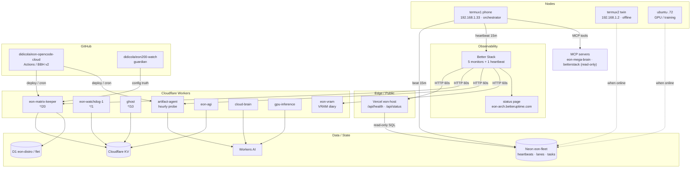

# EON Architecture Map

Live status page: **https://eon-arch.betteruptime.com**

> Better Stack **Catalog relations are paid-only** on the current plan (API returns `403 upgrade required`), so this Mermaid map is the free, versioned source of truth. The status page above is the live uptime view.

## Service graph

## Services and monitors

| Service | Role | Endpoint | Better Stack |
|---|---|---|---|
| EON host | public health | https://eon-host-own-c7f3.vercel.app/api/health | monitor `5100725` |
| EON host | status + quota | https://eon-host-own-c7f3.vercel.app/api/status | monitor `5100726` |
| EON matrix keeper | worker status | https://eon-matrix-keeper.eon-sovereign.workers.dev/status | monitor `5100727` |
| EON artifact agent | worker health | https://artifact-agent.eon-sovereign.workers.dev/healthz | monitor `5100728` |
| EON VRAM diary | diary read | https://eon-vram.eon-sovereign.workers.dev/read?addr=0xa0007000 | monitor `5100729` |
| EON termux1 phone | 15m heartbeat | Neon `eon.heartbeats` + Better Stack | heartbeat `513053` |

- Monitor cadence: **60 seconds**, email + push alerts.
- Heartbeat: **period 900s (15m)**, **grace 2700s (45m)**.
- Status page: **https://eon-arch.betteruptime.com** — section “EON Services”, all six resources.

## Data planes

- **Neon `eon-fleet`** (`nameless-dawn-68995682`, aws-us-east-2): `eon.heartbeats`, `eon.lanes`, task queue.
- **Cloudflare D1**: `eon-distro` (Linux images), `flet` (fleet registry / heartbeats).
- **Cloudflare KV**: worker state, ghost memory, lane stats.
- **Workers AI**: model lane used by artifact-agent, cloud-brain, gpu-inference.

## Known gaps (honest)

- **Catalog relations**: paid-only; this Mermaid map replaces them.
- **termux2** (`192.168.1.2`): no route / moved as of 2026-10-20.
- **ubuntu** (`192.168.1.72`): LAN up; SSH/ports firewalled; 443 mTLS half-up; heartbeat timer staged.
- **Vercel host**: read-only Neon role `wk_vercel`; cannot deploy from this phone.
- **Better Stack MCP**: OAuth is read-only; writes use a local API token stored `600`, never committed.

## Update procedure

1. Monitors/heartbeat/status page: Better Stack API from termux1 (`~/eon-tmp/.bstok`, mode `600`).
2. Phone heartbeat: `~/eon-tmp/heartbeat-run.sh` (Android JobScheduler, every 15m); ping URL in a `600` curl config.
3. Architecture map: edit this file and commit to `didicola/eon-opencode-cloud` (`main`).
4. Never commit tokens, ping URLs, or session cookies.
